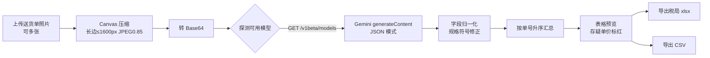

# 手写送货单电子化助手

> 拍摄手写送货单 → AI 自动识别明细 → 一键导出电子税务局「发票开具项目信息导入」模板。
>
> 纯前端单文件应用，零安装、零后端，图片和密钥都不离开你的浏览器。

<p>


</p>

**[▶ 在线使用](https://bobb1103.github.io/-/)** ｜ [功能特性](#功能特性) ｜ [工作原理](#工作原理) ｜ [常见问题](#常见问题)

---

## 目录

- [为什么做这个](#为什么做这个)
- [功能特性](#功能特性)
- [快速开始](#快速开始)
- [获取 Gemini API Key](#获取-gemini-api-key)
- [使用流程](#使用流程)
- [工作原理](#工作原理)
- [项目结构](#项目结构)
- [数据结构](#数据结构)
- [导出文件说明](#导出文件说明)
- [隐私与安全](#隐私与安全)
- [常见问题](#常见问题)
- [已知限制](#已知限制)
- [后续规划](#后续规划)
- [技术栈](#技术栈)

---

## 为什么做这个

仓库里原本只有一份手写送货单（同一品类、同一格式），每月要把几十张单据录进电子税务局，逐条抄「规格 / 单位 / 数量 / 单价」既慢又容易错。

于是做了这个小工具：拍照上传，AI 把明细读成结构化数据，直接生成税局导入模板，剩下的人工只做**核对**而不必**录入**。

它的目标很窄——把一件重复劳动从 40 分钟压到 3 分钟，所以刻意选择了最轻的形态：**一个 HTML 文件，双击即用，不上传服务器**。

## 功能特性

| 能力 | 说明 |
| --- | --- |
| 📷 批量识别 | 一次选多张照片，逐张处理，单张失败不影响其余 |
| 🔍 模型自动探测 | 启动时查询当前 Key 可用的模型列表，自动挑选可用端点，避免写死模型名导致的 `404` |
| 🗜️ 上传前压缩 | 长边压到 1600px、JPEG 质量 0.85，兼顾识别率与上传速度 |
| 🧮 金额自动计算 | 金额 = 数量 × 单价，保留两位小数；单价存疑的条目在表格中标红提示复核 |
| 🔀 自动排序 | 汇总结果按送货单号升序排列，便于与纸质单据对账 |
| 📊 双格式导出 | 税局标准四 Sheet 导入模板（`.xlsx`）＋ 通用明细表（`.csv`，含 BOM，Excel 直开不乱码） |
| 🔑 密钥本地保存 | API Key 存于 `localStorage`，可随时一键清除 |
| 📱 响应式 | Tailwind 布局，手机拍照后可直接处理 |

## 快速开始

**方式一：在线使用（无需下载）**

👉 **<https://bobb1103.github.io/-/>**

手机、电脑浏览器均可直接打开，配合手机拍照最顺手。

**方式二：直接打开本地文件**

下载 `index.html`，双击用浏览器打开即可。

**方式三：本地起静态服务**（个别浏览器对本地文件的限制较多时使用）

```bash
python -m http.server 8000
# 浏览器访问 http://localhost:8000
```

**方式四：自行部署**

Fork 仓库后，`Settings` → `Pages` → Source 选择 `main` 分支根目录，即可获得自己的站点地址。也可直接放在任何静态托管（Vercel、Netlify、OSS/COS 等）上，无需构建。

> 首次打开会要求填写 API Key，填一次即可，之后自动进入主界面。

## 获取 Gemini API Key

1. 打开 [Google AI Studio](https://aistudio.google.com/apikey)
2. 登录 Google 账号，点击 **Create API key**
3. 复制生成的 Key（形如 `AIza...`），粘贴到页面的密钥输入框，点击「保存密钥并开始使用」

> Key 只是保存在你的浏览器里，页面会直接向 Google 官方接口发起请求。免费额度通常足够日常小批量使用，具体以 Google 官方政策为准。

## 使用流程

1. **上传** — 选择一张或多张手写送货单照片（支持 `image/*`，可多选）
2. **设置税率** — 右上角选择发票默认税率：`13%` / `3%` / `1%` / `免税 0%`
3. **识别** — 点击「开始极速识别并转化」，页面显示逐张进度；完成后出现汇总表格
4. **导出** — 「导出税务发票模板」生成税局导入文件，或「导出常规 CSV」留档

## 工作原理



几个关键设计：

- **不写死模型名**：先请求 `/v1beta/models`，筛出支持 `generateContent` 的模型，排除已下线条目，优先选 `flash` 系列。端点解析后缓存，失败即清空缓存以便下次重新探测。这解决了「模型版本下线 → 全站 404」的典型故障。
- **强约束输出**：请求体带 `responseMimeType: application/json` 并用 `systemInstruction` 规定字段结构，保证返回可直接 `JSON.parse`；同时做了容错解析（数组 / `items` / `details` / 单对象都能接）。
- **规格文本规范化**：提示词要求乘号统一为 `*`；对含「防水袋」的品名额外做一次修正——把连写的 6 位数字按两位一组插入乘号（`303650` → `30*36*50`），因为手写单上这类规格最容易漏掉乘号。
- **税局模板对齐**：`1-明细模板` 表头严格复刻官方模板的三行结构（填表说明 / 字段限制 / 字段名），并补齐 `excelVersion`、`xzqhdm`、`2-特定业务信息` 三张校验用 Sheet。

## 项目结构

```
.
├── index.html    # 全部内容：页面结构 + 样式 + 业务逻辑
└── README.md
```

单文件形态是刻意的取舍：不需要 `npm install`、不需要构建，把文件丢到任何静态托管上就能用。代价是后续功能变复杂时需要拆分。

| 代码区块 | 位置 | 职责 |
| --- | --- | --- |
| `appState` | 脚本开头 | 全局状态：密钥、文件队列、识别结果、模型端点缓存 |
| `initKeySystem` / `showKeySetup` / `showMainContent` | 密钥模块 | 密钥存在性判断与界面切换 |
| `compressAndConvertToBase64` | 图像模块 | 读取、缩放、转 JPEG、输出 Base64 |
| `discoverWorkingEndpoint` | 模型模块 | 模型清单探测与端点缓存 |
| `callGeminiAPI` | 识别模块 | 构造请求、解析 JSON、字段归一化 |
| `renderTable` | 渲染模块 | 生成结果表格 HTML |
| `downloadTaxExcel` / `downloadCSV` | 导出模块 | 四 Sheet 模板与 CSV 生成 |

## 数据结构

识别结果统一为下列结构（`appState.extractedItems`）：

| 字段 | 类型 | 说明 |
| --- | --- | --- |
| `deliveryNo` | `string` | 送货单号，用于分组与排序 |
| `nameAndSpec` | `string` | 名称及规格，如 `FPP 双印 26.5*37+5+2.5` |
| `unit` | `string` | 单位，缺省 `只` |
| `quantity` | `number` | 数量 |
| `unitPrice` | `number` | 单价 |
| `isPriceCertain` | `boolean` | 单价是否确认清晰；`false` 时表格中单价标红，提示人工复核 |

## 导出文件说明

### 税局导入模板 `发票开具项目信息导入.xlsx`

| Sheet | 内容 |
| --- | --- |
| `1-明细模板` | 主体数据：项目名称、规格型号、单位、数量、单价、金额、税率、优惠政策类型 |
| `excelVersion` | 模板版本校验位（`mx;20250501`），税局系统据此识别模板版本 |
| `xzqhdm` | 行政区划校验表 |
| `2-特定业务信息` | 不动产等特定业务字段（本工具场景留空，仅为通过校验保留结构） |

> 政策口径：税率选「免税」时，`优惠政策类型` 自动填 `免税`。

### 通用明细 `送货单汇总数据.csv`

列：送货单号 / 项目名称 / 规格型号 / 单位 / 数量 / 单价 / 金额。带 UTF-8 BOM，Excel 双击打开不乱码。

## 隐私与安全

- **图片不出浏览器生态**：图像压缩在前端完成，仅以 Base64 随请求体发往 Google Gemini 官方接口，不经过任何第三方中转服务。
- **密钥仅存本地**：写入 `localStorage` 的 `GEMINI_API_KEY`，可随时点「重置/更换 API 密钥」清除。
- **注意事项**：`localStorage` 是明文存储，且前端直连意味着 Key 出现在浏览器请求中。请**不要在共用电脑上长期保留密钥**，用完即清；若需多人使用，建议改为自建后端代理转发。
- 仓库为「自用」性质，导入税务局前请**务必人工复核**识别结果。

## 常见问题

<details>
<summary><b>提示 404 / 模型不存在？</b></summary>

旧版本曾把模型名写死在代码里，模型下线后必然 404。当前版本改为运行时探测可用模型，正常情况下不会再出现。若仍失败，先确认 Key 有效、账号所在地区支持 Gemini API，再检查控制台报错信息。
</details>

<details>
<summary><b>识别结果为空或明显错乱？</b></summary>

依次排查：照片是否清晰、单据是否倾斜或过曝、单张照片内是否混排了多张单据。手写体连笔、涂改较多的单据建议重拍。可以在提示词里补充你单据的固定版式特征来提升命中率。
</details>

<details>
<summary><b>数量/单价读错怎么办？</b></summary>

当前表格为只读展示，识别结果需在导出的 Excel 里修正后再导入税局。带 `isPriceCertain: false` 的条目是模型自己标记的「不确定」，优先核对这些行。
</details>

<details>
<summary><b>为什么项目名称永远是「胶袋」？</b></summary>

这是为单一业务场景写死的常量（`renderTable` 与两个导出函数中都有）。换品类需要改代码，见 [已知限制](#已知限制)。
</details>

<details>
<summary><b>断网能用吗？</b></summary>

不能。页面依赖 CDN 加载 Tailwind、SheetJS 与字体，识别依赖在线模型接口。如需离线，可把这三个依赖下载到本地并改为相对路径。
</details>

## 已知限制

诚实列出当前实现的边界，便于判断是否适合你的场景：

- **品类写死**：项目名称固定为 `胶袋`，默认单位 `只`，属于单一业务定制，非通用工具
- **结果不可编辑**：识别后无法在页面上改数，只能导出后在 Excel 里调
- **串行处理**：多图逐张请求，图多时耗时线性增长，未做并发
- **排序假设**：按 `parseInt(单号)` 升序，非纯数字单号会被当作 0 排在最前
- **模板版本绑定**：`excelVersion` 固定为 `mx;20250501`，税局模板升级后需同步修改
- **字符集与地区**：仅面向中文手写单据与国内发票场景

## 后续规划

- [ ] 表格单元格可编辑，导出前直接改数
- [ ] 项目名称 / 单位改为界面可配置，去掉硬编码
- [ ] 多图并发识别 + 失败自动重试
- [ ] 识别结果本地暂存，刷新不丢
- [ ] 依赖本地化 + PWA，支持离线打开
- [ ] 单据模板自适应（不同版式的字段定位）

## 技术栈

- **界面**：原生 HTML/CSS + Tailwind CSS（CDN）
- **表格读写**：[SheetJS](https://sheetjs.com/) `xlsx@0.18.5`
- **识别**：Google Gemini Vision API（`v1beta/generateContent`，JSON 模式）
- **图像处理**：Canvas API（`drawImage` + `toDataURL`）
- **构建**：无。一个文件即全部。

---

## 免责声明

本工具仅为个人效率辅助，识别结果可能存在误差。**任何用于税务申报的数据，请以纸质原始单据为准并人工复核**；因直接采用识别结果造成的申报差错，由使用者自行承担。

## License

仓库未声明开源许可证。如需他人复用，建议补充 [MIT](https://choosealicense.com/licenses/mit/) 等许可证文件。
