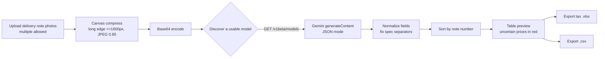

# AI Delivery Note to Spreadsheet

**AI 自动送货单识别生成表格**

> Photograph a handwritten delivery note → let AI extract every line item → export a ready-to-import invoice template in one click.
>
> A pure front-end, single-file app. No install, no backend. Your images and API key never leave your browser.

<p>


</p>

**[▶ Live demo](https://bobb1103.github.io/ai-delivery-note-to-spreadsheet/)** ｜ [Features](#features) ｜ [How it works](#how-it-works) ｜ [FAQ](#faq)

> **Language note.** The app UI and every file it generates are in **Simplified Chinese**, because the whole point is to feed China's e-tax portal, which validates Chinese sheet names and headers on import. This README is in English.

---

## Table of contents

- [Why this exists](#why-this-exists)
- [Features](#features)
- [Quick start](#quick-start)
- [Getting a Gemini API key](#getting-a-gemini-api-key)
- [How to use](#how-to-use)
- [How it works](#how-it-works)
- [Project structure](#project-structure)
- [Data model](#data-model)
- [Export files](#export-files)
- [Privacy and security](#privacy-and-security)
- [FAQ](#faq)
- [Known limitations](#known-limitations)
- [Roadmap](#roadmap)
- [Tech stack](#tech-stack)

---

## Why this exists

The only thing in this repo used to be one scanned handwritten delivery note — same product, same format, month after month. Dozens of them had to be keyed into the e-tax portal by hand, copying specification, unit, quantity and unit price line by line. Slow, and easy to get wrong.

So this tool does the transcribing: upload the photos, let the model turn them into structured rows, generate the import template. The human is left to **verify**, not to **type**.

The goal is deliberately narrow — compress a 40-minute chore into 3 minutes — which is why it takes the lightest possible shape: **one HTML file, double-click to run, nothing uploaded to a server**.

## Features

| Capability | Details |
| --- | --- |
| 📷 Batch recognition | Select many photos at once; each is processed independently, so one bad image doesn't sink the batch |
| 🔍 Model auto-discovery | On first use it queries which models your key can actually access and picks a working endpoint — no hard-coded model name, no `404` when a version is retired |
| 🗜️ Compress before upload | Long edge capped at 1600px, JPEG quality 0.85 — a balance between legibility and upload size |
| 🧮 Amounts computed for you | Amount = quantity × unit price, two decimals. Rows with an uncertain price are highlighted in red for review |
| 🔀 Auto-sorted | Results sorted by delivery note number, ascending, to make paper-to-screen reconciliation easy |
| 📊 Two export formats | The official four-sheet import template (`.xlsx`) plus a plain detail sheet (`.csv`, with BOM so Excel opens it without mojibake) |
| 🔑 Key stays local | The API key lives in `localStorage` and can be wiped with one click |
| 📱 Responsive | Tailwind layout; shoot on your phone and process it right there |

## Quick start

**Option 1: Use it online (nothing to download)**

👉 **<https://bobb1103.github.io/ai-delivery-note-to-spreadsheet/>**

Works in any mobile or desktop browser. Best experience: take the photo with your phone.

**Option 2: Open the file locally**

Download `index.html` and double-click it.

**Option 3: Serve it locally** (when a browser restricts `file://` pages)

```bash
python -m http.server 8000
# then open http://localhost:8000
```

**Option 4: Deploy your own**

Fork the repo, then `Settings` → `Pages` → source `main` branch, root folder. Or drop the file on any static host (Vercel, Netlify, S3/COS…). There is no build step.

> The first visit asks for an API key. Enter it once; afterwards you land straight on the main screen.

## Getting a Gemini API key

1. Open [Google AI Studio](https://aistudio.google.com/apikey)
2. Sign in with a Google account and click **Create API key**
3. Copy the key (looks like `AIza...`), paste it into the key field, and click **Save key and start**

> The key is only stored in your browser, and the page calls Google's API directly. The free tier is usually enough for small daily batches; check Google's current terms for limits.

## How to use

1. **Upload** — pick one or more photos of handwritten delivery notes (`image/*`, multi-select supported)
2. **Set the tax rate** — top right: `13%` / `3%` / `1%` / `Exempt (0)`
3. **Recognize** — click **Start recognition**; per-image progress is shown, then the summary table appears
4. **Export** — **Export invoice template** for the tax-portal file, or **Export plain CSV** for your own records

## How it works



Four design decisions worth knowing:

- **No hard-coded model name.** It first calls `/v1beta/models`, keeps the ones supporting `generateContent`, filters out retired families, and prefers a `flash` model. The resolved endpoint is cached, and the cache is cleared on any failure so the next run re-detects. This is what prevents the classic "model version gets retired → the whole app 404s" failure.
- **Constrained output.** Requests set `responseMimeType: application/json` and use `systemInstruction` to pin the field structure, so the response parses directly. The parser is also forgiving: it accepts a bare array, `items`, `details`, or a single object.
- **Spec text normalization.** The prompt requires `*` as the multiplication sign. For item names containing 防水袋 (waterproof bag) it applies one extra fix — a run of six written-together digits gets separators inserted in pairs (`303650` → `30*36*50`), because that spec is the one most often missing its `*` on handwritten notes.
- **Aligned with the official template.** The `1-明细模板` sheet reproduces the official three-row header structure exactly (instructions row / field limits row / field names row), and the workbook also carries the `excelVersion`, `xzqhdm` and `2-特定业务信息` sheets the portal expects for validation.

## Project structure

```
.
├── index.html    # everything: markup + styles + application logic
└── README.md
```

The single-file shape is a deliberate trade-off: no `npm install`, no build, drop it on any static host and it works. The cost is that it will need splitting once the feature set grows.

| Code block | Location | Responsibility |
| --- | --- | --- |
| `appState` | top of script | Global state: key, file queue, extracted items, cached model endpoint |
| `initKeySystem` / `showKeySetup` / `showMainContent` | key module | Check whether a key exists and switch views |
| `compressAndConvertToBase64` | image module | Read, resize, re-encode as JPEG, output Base64 |
| `discoverWorkingEndpoint` | model module | Probe the model list and cache the endpoint |
| `callGeminiAPI` | recognition module | Build the request, parse JSON, normalize fields |
| `renderTable` | render module | Build the results table HTML |
| `downloadTaxExcel` / `downloadCSV` | export module | Generate the four-sheet workbook and the CSV |

## Data model

Every recognised row shares this shape (`appState.extractedItems`):

| Field | Type | Meaning |
| --- | --- | --- |
| `deliveryNo` | `string` | Delivery note number; used for grouping and sorting |
| `nameAndSpec` | `string` | Item name and specification, e.g. `FPP 双印 26.5*37+5+2.5` |
| `unit` | `string` | Unit of measure; defaults to `只` |
| `quantity` | `number` | Quantity |
| `unitPrice` | `number` | Unit price |
| `isPriceCertain` | `boolean` | Whether the price was read confidently; `false` renders it in red so you review that row |

## Export files

### Tax portal import template — `发票开具项目信息导入.xlsx`

| Sheet | Contents |
| --- | --- |
| `1-明细模板` | The payload: item name, specification, unit, quantity, unit price, amount, tax rate, tax preference type |
| `excelVersion` | Template version marker (`mx;20250501`); the portal uses it to identify the template version |
| `xzqhdm` | Administrative division validation sheet |
| `2-特定业务信息` | Special-business fields such as real estate; left blank here, kept only so validation passes |

> Rule: when the tax rate is set to **Exempt**, the tax preference type is filled in as `免税` (exempt).

> ⚠️ **Keep these labels in Chinese.** Sheet names, header rows and the file name are validated by the e-tax portal. Translating them produces a file that opens fine but cannot be imported.

### Plain detail sheet — `送货单汇总数据.csv`

Columns: delivery no. / item name / specification / unit / quantity / unit price / amount. UTF-8 with BOM, so Excel opens it cleanly on double-click.

## Privacy and security

- **Images stay out of any middleman.** Compression happens in the browser; the image is sent as Base64 directly to Google's Gemini endpoint. No third-party relay is involved.
- **The key is local only.** Written to `localStorage` under `GEMINI_API_KEY`, removable at any time via **Reset / change API key**.
- **Caveats.** `localStorage` is plaintext, and a front-end-only design means the key is visible in browser requests. Don't leave a key on a shared machine — clear it when you're done. For multi-user deployments, put a small backend proxy in front instead.
- This is a personal-use tool. **Always verify** the recognised data against the paper originals before filing anything with the tax authority.

## FAQ

<details>
<summary><b>I get a 404 / "model not found".</b></summary>

Earlier versions hard-coded the model name, so a retirement meant a guaranteed 404. The current version discovers available models at runtime, so this should no longer happen. If it does: confirm the key is valid, confirm Gemini API is available in your account's region, then read the console error for the exact response.
</details>

<details>
<summary><b>Nothing is recognised, or the output is clearly wrong.</b></summary>

Check in this order: is the photo sharp, is the sheet skewed or overexposed, are multiple notes crammed into one frame. Rewrite notes with heavy cursive or corrections. You can also add your form's fixed layout hints to the prompt to improve hit rate.
</details>

<details>
<summary><b>Quantity or unit price came out wrong. What now?</b></summary>

The on-screen table is read-only, so fix values in the exported Excel before importing. Rows with `isPriceCertain: false` are the ones the model itself flagged as uncertain — review those first.
</details>

<details>
<summary><b>Why is the item name always 胶袋 (plastic bag)?</b></summary>

It's a constant hard-coded for one specific business line (it appears in `renderTable` and in both export functions). Supporting another product means changing the code — see [Known limitations](#known-limitations).
</details>

<details>
<summary><b>Does it work offline?</b></summary>

No. The page loads Tailwind, SheetJS and a webfont from CDNs, and recognition needs the online model endpoint. To go offline, vendor those three dependencies locally and switch to relative paths.
</details>

## Known limitations

Stated plainly, so you can judge whether it fits your case:

- **Single product, hard-coded.** Item name is fixed to `胶袋` and the default unit to `只`. This is a bespoke tool, not a general-purpose one.
- **Results aren't editable.** You can't correct a number on the page; you fix it in Excel after export.
- **Sequential processing.** Images are sent one at a time, so time grows linearly with batch size. No concurrency.
- **Sorting assumes numeric IDs.** Rows sort by `parseInt(deliveryNo)`, so non-numeric note numbers collapse to 0 and land at the top.
- **Pinned template version.** `excelVersion` is fixed at `mx;20250501`; it needs updating when the official template changes.
- **Language and region.** Built for Chinese handwritten notes and mainland invoicing only. The UI is in Simplified Chinese.

## Roadmap

- [ ] Editable table cells, so values can be fixed before export
- [ ] Configurable item name and unit, removing the hard-coded values
- [ ] Concurrent recognition with automatic retry
- [ ] Persist results locally across refreshes
- [ ] Vendor dependencies + PWA for offline use
- [ ] Adapt to different note layouts (field localization per template)

## Tech stack

- **UI**: plain HTML/CSS + Tailwind CSS (CDN)
- **Spreadsheet I/O**: [SheetJS](https://sheetjs.com/) `xlsx@0.18.5`
- **Recognition**: Google Gemini API (`v1beta/generateContent`, JSON mode)
- **Image processing**: Canvas API (`drawImage` + `toDataURL`)
- **Build**: none. One file is the whole thing.

---

## Disclaimer

This tool is a personal productivity aid, and recognition can be wrong. **Any figure filed with a tax authority must be checked against the original paper document.** Errors arising from using the output as-is are the user's own responsibility.

## License

No license is declared. If you want others to reuse this, consider adding [MIT](https://choosealicense.com/licenses/mit/).
